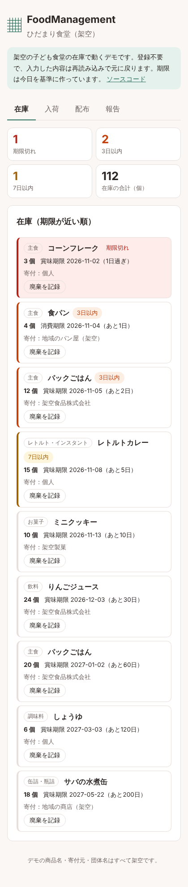
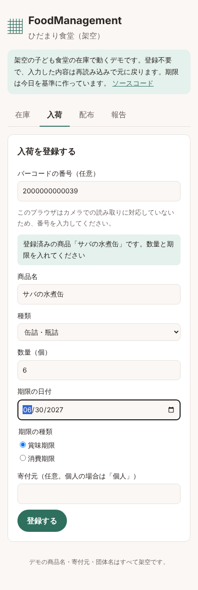
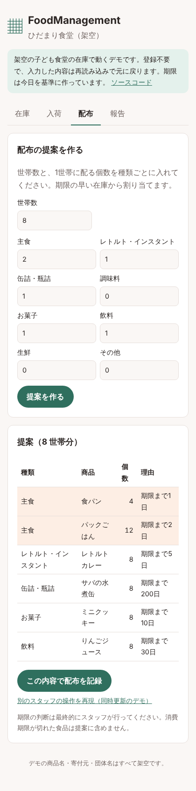
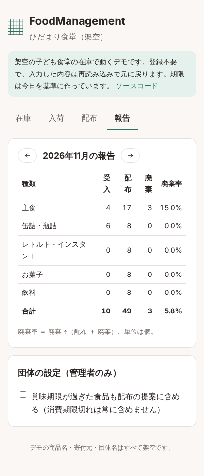
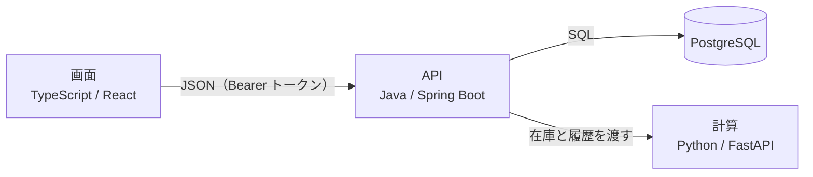
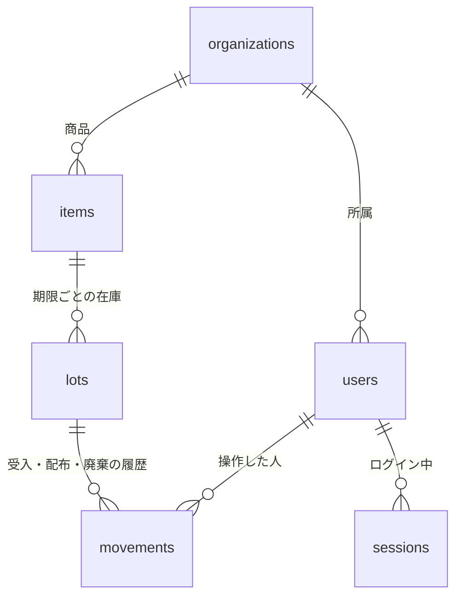
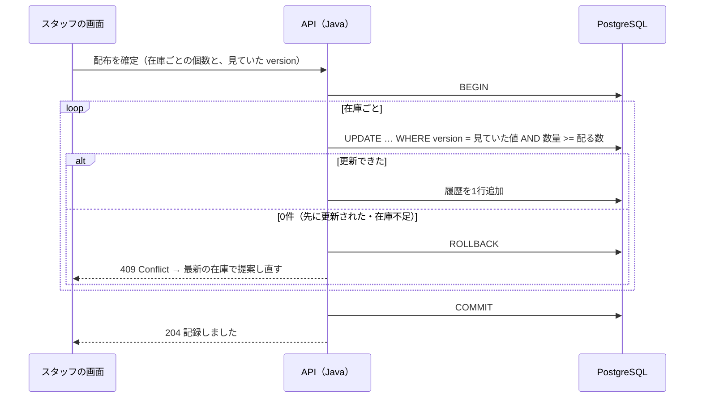

# FoodManagement

**日本語** | [English](README.en.md)

[](https://github.com/cedarcraftworks/FoodManagement/actions/workflows/ci.yml)
[](https://cedarcraftworks.github.io/FoodManagement/)

子ども食堂・フードバンク向けに、寄付された食品の**在庫と賞味期限をスマホで共有**し、配布会では**期限の早い物から何をいくつ配るかを提案**するWebアプリです。期限切れによる廃棄を減らすことを目指しています。

**[▶ デモを開く](https://cedarcraftworks.github.io/FoodManagement/)**（登録不要。架空の子ども食堂の在庫で動きます）

| 在庫 | 入荷 | 配布 | 報告 |
| --- | --- | --- | --- |
|  |  |  |  |

## 解決したい課題

子ども食堂やフードバンクでは、寄付された食品の期限を紙やLINE、表計算で管理していることが多く、次のようなことが起きやすいと言われています。

- 期限が近い食品に気付くのが遅れ、期限切れで捨ててしまう
- 倉庫を見に行かないと、何がどれだけあるか分からない
- ボランティアが入れ替わるので、引き継ぎが口頭やメモ頼りになる
- どれから配るかを、経験のある人の勘で決めている
- 助成金や自治体への報告のために、受入・配布の量を手で集計している

（これらは一般的に言われている課題をもとにした想定で、実際の団体への聞き取りで確かめていく予定です。）

## できること

1. **在庫を期限が近い順に表示**：期限切れ・3日以内・7日以内を色で区別
2. **入荷の登録**：バーコード（JANコード）をカメラか手入力で読み、一度登録した商品は名前が自動で入る。番号はチェックデジットで読み間違いを確かめる
3. **配布の提案**：世帯数と「1世帯あたり何個」を入れると、期限の早い在庫から割り当てを提案し、足りない種類も示す
4. **同時更新の検知**：複数のスタッフが同時に在庫を減らしても数がずれない（楽観的ロック）
5. **月次の報告**：受入・配布・廃棄の個数と廃棄率を種類別に集計
6. **役割**：団体の管理者とスタッフを分け、設定の変更とスタッフの追加は管理者だけ

詳しくは [要件定義書](docs/requirements.md) と、スタッフ向けの [使い方の説明書](docs/user-guide.md) を見てください。

## 設計で大事にしたこと

- **危険な物を配らせない**：消費期限が切れた食品は、どんな設定でも提案に含めません。賞味期限切れは団体の判断に任せ、初期設定では含めません。
- **数を絶対にずらさない**：在庫を減らすときは「見ていた版番号（version）」が今と同じか、在庫が足りるかを1つのSQLで確かめます。配布の確定は1つのトランザクションで、1つでも失敗したら全部取り消します。数量には「0以上」の制約をデータベースにもかけています。
- **履歴をすべて残す**：在庫の数を変えるときは、同じトランザクションで入出庫の履歴を1行追加します。報告はこの履歴から作ります。
- **個人情報を持たない**：配布先の世帯は数だけを扱い、名前や住所は入力しません。
- **同じ入力なら必ず同じ結果**：「今日」の日付を外から渡し、配布提案の規則は [共通テストケース](contract/cases.json) で固定しています。

## 工夫したこと・難しかったこと

| 課題 | どうしたか |
| --- | --- |
| 2人が同時に同じ在庫を減らすと数がずれる | 版番号（version）を使う楽観的ロックにした。「残りの数」ではなく「減らす数」と「見ていた version」を送り、1つの UPDATE 文で確かめる |
| 配布は複数の在庫をまとめて減らすので、途中で失敗すると一部だけ減ってしまう | 1つのトランザクションにまとめ、1つでも失敗したら全部取り消す。テストで「ごはんは減らず、カレーだけ先に更新された」状況を再現して確かめた |
| 「今日」がいつかで期限の判断が変わる | 日本時間の「今日」を1か所（`Clock`）で決め、計算には外から渡す。テストでは日付を固定して、いつ実行しても同じ結果にした |
| 計算の規則を Python（本番）と TypeScript（デモ）の2か所に書く必要がある | 同じ JSON のテストケース（[contract/cases.json](contract/cases.json)）を両方のテストで読み、結果がずれたら CI で失敗するようにした |
| バーコードの読み間違い・打ち間違い | JAN のチェックデジットを画面と API の両方で確かめ、間違った番号は登録しない |
| 食品の安全 | 消費期限切れは設定に関係なく提案しない。「配ってよい」とは断定せず、期限の早い順の判断材料を出すだけにした |

## 構成



| 部分 | 技術 | 役割 |
| --- | --- | --- |
| [web/](web) | TypeScript、React、esbuild、Biome、Playwright | 在庫・入荷・配布・報告の画面。デモ版は計算もブラウザ内で行う |
| [api/](api) | Java 21、Spring Boot 3、Spring Security、Flyway、OpenAPI、Testcontainers、JaCoCo | ログインと役割、在庫の更新（楽観的ロック・トランザクション）、計算サービスへの中継 |
| [planner/](planner) | Python 3.12、FastAPI、pytest、mypy、ruff | 期限の早い物から配る割り当て（FEFO）と月次集計 |
| [contract/](contract) | JSON | Python と TypeScript が同じ結果を返すことを確かめる共通テストケース |

**なぜ3つの言語に分けたか**：在庫の整合性とログイン・権限は堅さが大事なので Java、日付と数量の計算や集計は Python が書きやすく、画面は型で入力ミスを防げる TypeScript を選びました。配布提案の規則は Python と TypeScript の両方にあり、同じテストケースを両方で通すことで、2つがずれないようにしています。

**データの関係**（同じ商品でも期限が違えば別の在庫として扱い、在庫を変えるたびに履歴を残す）



**配布を確定するときの流れ**（どれか1つでも先に更新されていたら全部取り消す）



API の仕様書は、起動後に `http://localhost:8080/swagger-ui.html` で見られます（OpenAPI から自動生成）。

## 動かし方

```bash
# デモ版の画面だけ（サーバー不要）
cd web && npm install && npm run dev            # http://localhost:5173

# 全体（PostgreSQL・計算サービス・API）
docker compose up --build
cd web && npm install && API_URL=http://localhost:8080 npm run dev:api
```

## テスト

| 対象 | コマンド | 主な内容 |
| --- | --- | --- |
| Python | `cd planner && pytest && mypy` | 共通ケース（期限の区分、配布の割り当て、月次集計）、API の入出力 |
| Java | `cd api && mvn verify`（Docker が必要） | 登録・ログイン、管理者だけの操作、他の団体のデータに触れないこと、楽観的ロック、配布の全部取り消し、バーコードの確認 |
| TypeScript | `cd web && npm test && npm run typecheck` | 共通ケース、JANのチェックデジット、デモでの同時更新 |
| ブラウザ | `cd web && npm run build:demo && npm run e2e` | 本物のブラウザで「在庫→廃棄→入荷→配布（同時更新の検知を含む）→報告」を操作 |

すべて GitHub Actions で、変更のたびに自動で実行しています。

## 今後やること

- 地域の子ども食堂・フードパントリーに話を聞き、実際の課題に合わせて直す
- 配布会の当日に電波が弱くても使えるようにする（オフライン対応）
- 寄付元ごとの受入量の集計

## 注意

デモの商品名・寄付元・団体名はすべて架空です。デモの JAN コードは店舗内で使う 20 番台の架空の番号です。期限の判断は最終的にスタッフが行ってください。

## 開発について

個人開発です。生成AI（Claude）を活用して開発しました。

## ライセンス

[MIT](LICENSE)
