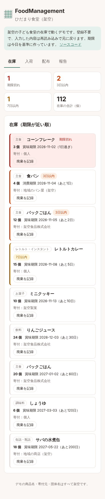
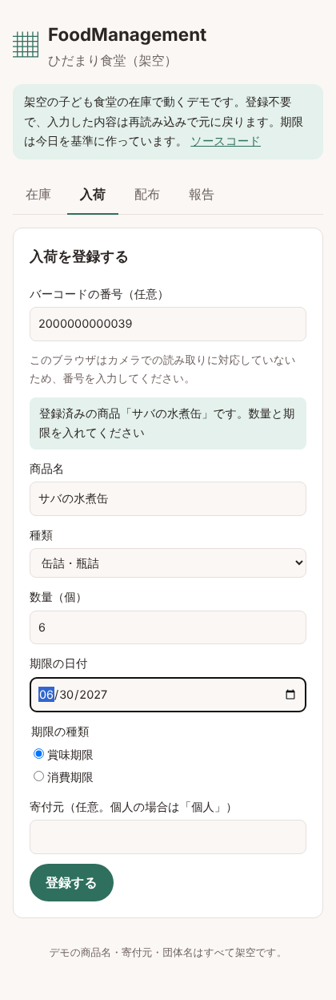
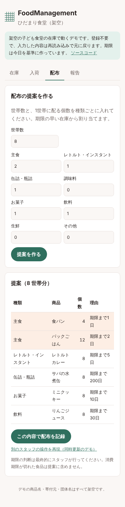
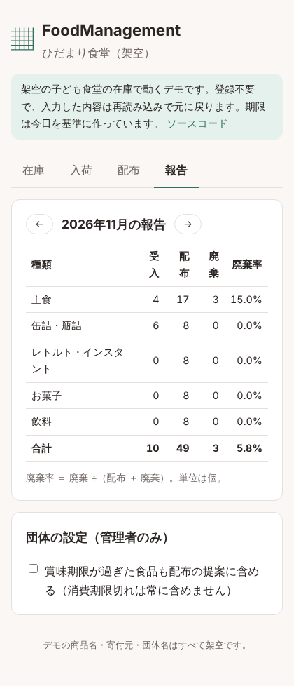

# FoodManagement 使い方（スタッフ向け）

FoodManagement は、寄付された食品の在庫と期限をスマホで共有し、配布会では期限の早い物から配る内容を提案するアプリです。

まず試すときは [デモ](https://cedarcraftworks.github.io/FoodManagement/) を開いてください。登録なしで、架空の子ども食堂の在庫で操作できます（入力した内容は再読み込みで元に戻ります）。

画面は上のタブで切り替えます：**在庫**・**入荷**・**配布**・**報告**。

---

## 1. はじめに（管理者のみ）

1. 「はじめての団体は登録」を押し、団体名・メールアドレス・パスワード（8文字以上）を入れて登録します。登録した人が団体の**管理者**になります。
2. スタッフのアカウントは管理者が追加します。スタッフは受け取ったメールアドレスとパスワードでログインします。

---

## 2. 在庫を見る

- 上の4つの数字は、**期限切れ**・**3日以内**・**7日以内**の在庫の件数と、在庫の合計個数です。
- 一覧は**期限が近い順**に並びます。期限切れは赤、3日以内は橙、7日以内は黄の線で示します。
- 「賞味期限」と「消費期限」を区別して表示します。

**期限切れや傷みで食品を捨てたとき**

1. その在庫の「廃棄を記録」を押します。
2. 捨てた個数を入れて OK を押します。報告の「廃棄」に数えられます。

---

## 3. 入荷を登録する

1. **バーコードの番号**を入れます（任意）。
   - 対応しているスマホ（Android の Chrome など）では「カメラで読む」を押して、商品のバーコードを撮影できます。
   - 対応していない場合は、バーコードの下の数字（13桁か8桁）を入力してください。
   - 番号が間違っていると「最後の1桁が合いません」と表示されます。もう一度確かめてください。
2. 以前に登録したことがある商品なら、**商品名と種類が自動で入ります**。はじめての商品は自分で入れてください。
3. **数量**、**期限の日付**、**期限の種類**（賞味期限か消費期限か）を入れます。
4. **寄付元**は任意です。個人からの寄付は名前を書かず「個人」と入れてください。
5. 「登録する」を押します。

> 賞味期限：おいしく食べられる期限。消費期限：安全に食べられる期限（お弁当・パンなど傷みやすい物）。

---

## 4. 配布会で配る

1. 今日の**世帯数**を入れます。
2. 種類ごとに**1世帯に配る個数**を入れます（配らない種類は0）。
3. 「提案を作る」を押すと、**期限の早い在庫から**割り当てた一覧が出ます。
   - 期限が3日以内の行は色が付きます。
   - 在庫が足りない種類は「○○が △ 個足りません」と表示されます。寄付のお願いに使ってください。
4. 一覧の通りに棚から取り出し、「この内容で配布を記録」を押します。在庫が減り、報告の「配布」に数えられます。

**「他のスタッフが先に在庫を更新したため、確定しませんでした」と出たとき**

同じ時間に別のスタッフが同じ食品を配ったり捨てたりしたためです。在庫は何も変わっていません。自動で最新の在庫から提案し直すので、内容を確かめてから、もう一度「この内容で配布を記録」を押してください。

> 消費期限が切れた食品は、提案に入りません。賞味期限が切れた食品は、管理者が「報告」画面の設定で「含める」にしたときだけ提案に入ります。期限の判断は、最終的にスタッフが行ってください。

---

## 5. 報告を見る

- 月ごとの**受入**・**配布**・**廃棄**の個数と**廃棄率**（廃棄 ÷（配布 ＋ 廃棄））を、種類別に表示します。
- 「←」「→」で前後の月に切り替えます。助成金や自治体への報告に使えます。

**団体の設定（管理者のみ）**

「賞味期限が過ぎた食品も配布の提案に含める」をオンにすると、賞味期限切れの食品も提案に入ります（その場合は「賞味期限を○日過ぎています」と表示されます）。消費期限切れは、この設定に関係なく入りません。

---

## よくある質問

**Q. 2人で同時に入力しても大丈夫？**
はい。同じ在庫を同時に減らそうとしたときは、後から押した人に「他のスタッフが先に更新しました」と表示され、数がずれることはありません。

**Q. 配布先の人の名前を入れる必要はある？**
いいえ。世帯数だけを入れます。個人情報は扱いません。

**Q. 間違えて登録したときは？**
今の版では、入荷の取り消しはできません。間違えた分は「廃棄を記録」で数を合わせ、管理者に伝えてください（今後、修正機能を追加する予定です）。
